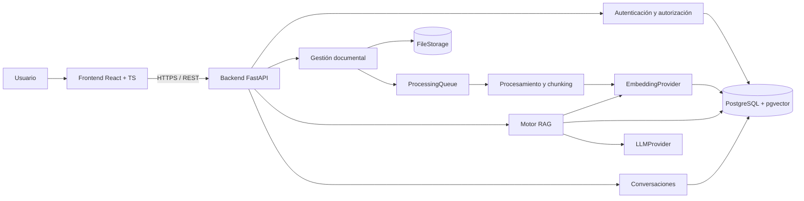

# SmartDocs AI

Plataforma empresarial de consulta inteligente de documentación corporativa basada en arquitectura **RAG (Retrieval-Augmented Generation)**.

SmartDocs AI permite cargar documentos internos (PDF, DOCX y TXT), procesarlos, indexarlos y consultarlos mediante un asistente conversacional que responde **exclusivamente** con información recuperada de esas fuentes, citando los documentos y fragmentos utilizados.

> **Estado actual:** Etapas 1 y 2 cerradas. Próxima: Etapa 3 — gestión documental.
>
> Este repositorio se construirá de forma incremental. Cada etapa debe dejar un resultado funcional y verificable antes de avanzar.

---

## Problema que resuelve

En las organizaciones la información suele estar dispersa en PDFs, documentos Word, planillas y archivos sin control de versiones. Esto provoca:

- Pérdida de tiempo buscando procedimientos y políticas.
- Duplicados y versiones contradictorias.
- Consultas repetitivas que consumen tiempo del personal.
- Dificultad para incorporar nuevos empleados.
- Respuestas informales o desactualizadas.

SmartDocs AI centraliza ese conocimiento y lo expone mediante una interfaz conversacional con referencias verificables.

---

## Funcionalidades principales

### Panel administrativo

- Gestión de documentos: carga, listado, estado de procesamiento, reproceso y eliminación.
- Detección de duplicados por checksum.
- Gestión de usuarios, roles y permisos.
- Historial de conversaciones, consultas sin resultado y actividad.

### Asistente conversacional

- Preguntas en lenguaje natural.
- Conversaciones con contexto.
- Respuestas con fuentes, documento, sección y página cuando estén disponibles.
- Respuesta canónica cuando no hay información suficiente, sin inventar procedimientos.
- Acceso al documento y fragmento de origen.

### Seguridad empresarial

- Autenticación JWT con refresh tokens revocables.
- Roles `ADMIN` y `USER`.
- Aislamiento estricto por organización derivado de la identidad autenticada.
- Filtrado de permisos también sobre los fragmentos recuperados de la base vectorial.
- Contenido documental tratado como dato no confiable (defensa ante prompt injection).

---

## Stack tecnológico

| Componente | Tecnología | Responsabilidad |
|---|---|---|
| Backend | Python 3.12 | Lógica de negocio |
| API | FastAPI | Servicios REST |
| Validación | Pydantic v2 | DTOs y configuración |
| ORM | SQLAlchemy 2.0 async | Persistencia |
| Migraciones | Alembic | Evolución del esquema |
| Base de datos | PostgreSQL 16 | Datos relacionales |
| Vector store | pgvector | Embeddings y búsqueda semántica |
| Generación | Gemini API (abstraído) | Respuestas del asistente |
| Embeddings | Gemini (configurable) | Representación vectorial |
| Procesamiento | PyMuPDF / python-docx | Extracción de texto |
| Autenticación | JWT + Argon2id | Sesiones y contraseñas |
| Frontend | React + TypeScript + Vite | Interfaz web |
| Testing | Pytest + Vitest | Pruebas automatizadas |
| Evaluación RAG | RAGAS + dataset propio | Calidad de recuperación y generación |
| Contenedores | Docker + Docker Compose | Entorno de ejecución |
| Calidad de código | Ruff | Lint y formato |

Las decisiones y su justificación están en [`docs/decisions.md`](docs/decisions.md).

---

## Arquitectura en una imagen



El detalle de componentes, flujos y límites está en [`docs/architecture.md`](docs/architecture.md).

---

## Estructura objetivo del repositorio

```text
smartdocs-ai/
├── backend/
│   ├── app/
│   │   ├── api/routes/
│   │   ├── core/
│   │   ├── database/
│   │   ├── models/
│   │   ├── schemas/
│   │   ├── repositories/
│   │   ├── services/
│   │   ├── rag/
│   │   ├── document_processing/
│   │   └── main.py
│   ├── migrations/
│   ├── tests/
│   ├── pyproject.toml
│   ├── requirements.txt
│   └── Dockerfile
├── frontend/
│   ├── src/
│   │   ├── components/
│   │   ├── pages/
│   │   ├── services/
│   │   ├── hooks/
│   │   └── contexts/
│   └── package.json
├── docs/
├── docker-compose.yml
├── .env.example
├── .gitignore
├── README.md
└── ROADMAP.md
```

La estructura se creará en la Etapa 2 (backend) y la Etapa 7 (frontend).

---

## Documentación

| Documento | Contenido |
|---|---|
| [`ROADMAP.md`](ROADMAP.md) | Plan de 10 etapas con tareas, entregables, criterios y checklists |
| [`docs/requirements.md`](docs/requirements.md) | Requisitos funcionales y no funcionales, alcance y límites |
| [`docs/architecture.md`](docs/architecture.md) | Componentes, capas, flujos e interfaces desacopladas |
| [`docs/database.md`](docs/database.md) | Modelo de datos, ERD, índices, multi-tenancy y migraciones |
| [`docs/api.md`](docs/api.md) | Convenciones REST y contrato de endpoints |
| [`docs/rag-pipeline.md`](docs/rag-pipeline.md) | Ingesta, chunking, embeddings, retrieval, prompt y guardrails |
| [`docs/security.md`](docs/security.md) | Autenticación, autorización, aislamiento y prompt injection |
| [`docs/testing.md`](docs/testing.md) | Estrategia de pruebas, dataset dorado y métricas RAG |
| [`docs/deployment.md`](docs/deployment.md) | Docker, configuración, HTTPS y comparativa de hosting |
| [`docs/decisions.md`](docs/decisions.md) | Registro de decisiones de arquitectura (ADR) |
| [`docs/glossary.md`](docs/glossary.md) | Conceptos clave y preguntas de entrevista |

Índice general: [`docs/README.md`](docs/README.md).

---

## Plan de desarrollo

El proyecto se divide en 10 etapas incrementales, estimadas en **15 semanas** para una persona trabajando 5–7 horas semanales:

| # | Etapa | Duración |
|---|---|---:|
| 1 | Análisis y planificación | 1 semana |
| 2 | Entorno y estructura del backend | 1 semana |
| 3 | Gestión documental | 1 semana |
| 4 | Extracción y procesamiento | 1 semana |
| 5 | Embeddings y búsqueda vectorial | 2 semanas |
| 6 | Motor RAG | 2 semanas |
| 7 | Frontend | 2 semanas |
| 8 | Seguridad y permisos empresariales | 1 semana |
| 9 | Testing y evaluación de calidad | 2 semanas |
| 10 | Despliegue y documentación | 1 semana |

Hitos principales: **MVP backend** (Etapa 4), **RAG demostrable sin LLM** (Etapa 5), **RAG completo con fuentes** (Etapa 6), **producto usable desde web** (Etapa 7), **listo para producción** (Etapa 10).

---

## Principios del proyecto

1. Construir primero una solución pequeña que funcione, medirla y luego ampliar.
2. No usar LangChain inicialmente: implementar el pipeline RAG directamente para comprender cada componente.
3. Mantener proveedores de IA desacoplados mediante interfaces.
4. Proteger los datos por organización desde el MVP, no después.
5. Reconocer la falta de información en lugar de improvisar respuestas.
6. Documentar las decisiones y las limitaciones conocidas.
7. No implementar funcionalidades que todavía no sean necesarias.

---

## Puesta en marcha

Requisitos: Python 3.12, `uv`, Docker y Docker Compose. Si `uv` no está en el `PATH`, reemplazar `uv` por `python -m uv`.

1. Copiar `.env.example` a `.env` y ajustar `POSTGRES_PASSWORD`, `DATABASE_URL`, `DATABASE_TEST_URL` y `JWT_SECRET` (mínimo 32 caracteres aleatorios).
2. Instalar dependencias: `cd backend && uv sync --dev`.
3. Levantar PostgreSQL con pgvector: `docker compose up -d db`.
4. Aplicar migraciones: `cd backend && uv run alembic upgrade head`.
5. Crear la organización y el administrador inicial:
   ```bash
   uv run python -m app.cli create-organization --name "Acme" --slug acme
   uv run python -m app.cli create-admin --organization-slug acme --email admin@acme.com --name "Admin"
   ```
   La contraseña se solicita de forma interactiva o se toma de `ADMIN_PASSWORD`.
6. Ejecutar la API: `uv run uvicorn app.main:app --reload`.
7. Abrir Swagger en <http://localhost:8000/docs> y verificar `GET /health`.

Con Docker: `docker compose up --build` levanta API y base de datos. Las migraciones se aplican aparte con `docker compose run --rm api alembic upgrade head`.

Tests: `cd backend && uv run pytest --cov=app`. La suite usa `DATABASE_TEST_URL` y requiere PostgreSQL real con las extensiones `citext` y `vector`.

---

## Licencia

Por definir.
