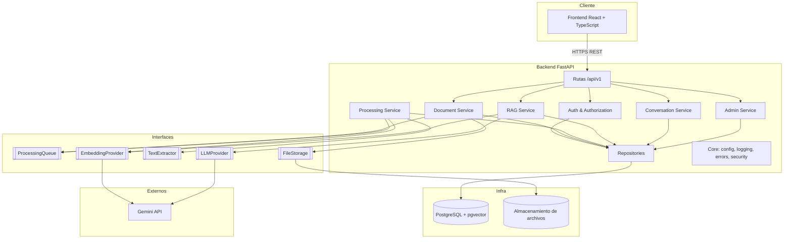
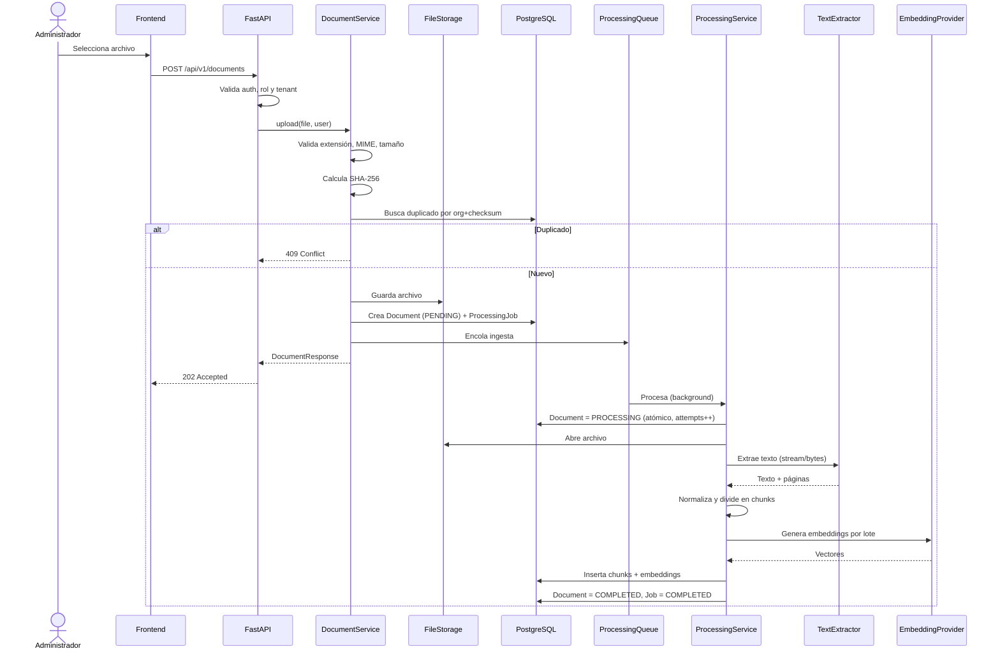
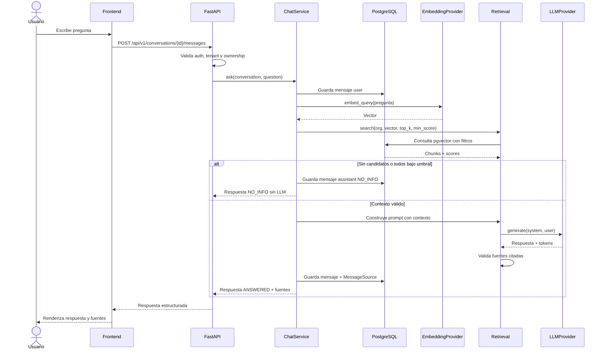
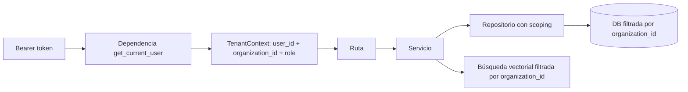
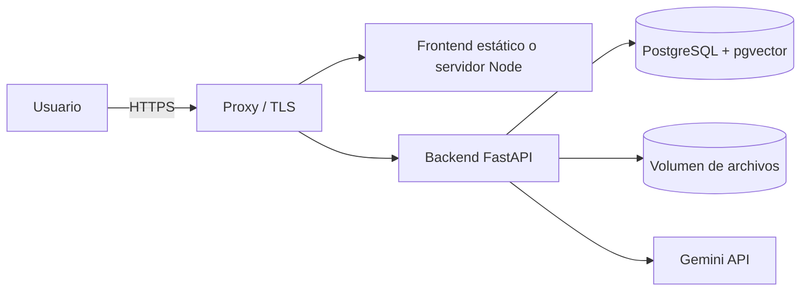

# Arquitectura — SmartDocs AI

Diseño de la arquitectura general, componentes, capas, flujos e interfaces.

- **Estilo:** monolito modular con separación estricta de responsabilidades.
- **Backend:** Python 3.12 + FastAPI + SQLAlchemy 2.0 async.
- **Persistencia:** PostgreSQL 16 + pgvector.
- **Frontend:** React + TypeScript + Vite.
- **Proveedores externos:** abstraídos mediante interfaces.

---

## 1. Principios arquitectónicos

1. **Monolito modular:** un solo despliegue, módulos con límites claros. Permite extraer servicios luego si el volumen lo justifica.
2. **Separación de capas:** las rutas no contienen lógica de negocio ni SQL.
3. **Inversión de dependencias:** servicios dependen de interfaces, no de SDKs concretos.
4. **Multi-tenancy explícita:** el contexto de organización se propaga desde la autenticación a todas las capas.
5. **Procesamiento desacoplado:** la carga no bloquea la request; el pipeline se ejecuta detrás de `ProcessingQueue`.
6. **Contenido no confiable:** los documentos son datos, nunca instrucciones para el modelo.
7. **Fallar de forma segura:** ante duda, negar acceso o responder `NO_INFO`.

---

## 2. Vista de componentes



---

## 3. Capas y responsabilidades

| Capa | Directorio | Responsabilidad | Reglas |
|---|---|---|---|
| API / Rutas | `app/api/routes/` | Recibir requests, validar DTOs, delegar, serializar | Sin lógica de negocio ni acceso directo a la base |
| Dependencias | `app/api/dependencies.py` | Autenticación, contexto de tenant, sesión de DB, paginación | Única fuente de `organization_id` |
| Servicios | `app/services/` | Casos de uso, transacciones, reglas de negocio | Dependen de repositorios e interfaces |
| Repositorios | `app/repositories/` | Consultas y persistencia | Scoping obligatorio por organización |
| Modelos | `app/models/` | Entidades SQLAlchemy | Sin lógica de negocio |
| Schemas | `app/schemas/` | DTOs Pydantic de entrada/salida | No exponer modelos ORM directamente |
| Core | `app/core/` | Configuración, seguridad, logging, errores | Sin dependencias de dominio |
| RAG | `app/rag/` | Chunking, embeddings, retrieval, prompt, generación | Sin acceso a HTTP ni a la sesión de DB |
| Procesamiento | `app/document_processing/` | Extractores y normalización | Sin lógica de persistencia |
| Base de datos | `app/database/` | Engine, sesión, base declarativa | Único punto de configuración de DB |
| Migraciones | `backend/migrations/` | Evolución del esquema con Alembic | Revisadas antes de aplicar |

### Regla de dependencias

```text
routes → services → repositories → models
                 ↘ rag / document_processing
                 ↘ interfaces (storage, queue, llm, embeddings)
core es transversal y no depende de dominio.
```

Ninguna capa inferior importa capas superiores.

---

## 4. Estructura modular del backend

> **Estado:** este árbol es la estructura objetivo. La tabla de implementación al final de la sección indica qué existe al cerrar la Etapa 2 y qué se incorpora en etapas posteriores.

```text
backend/
├── app/
│   ├── api/
│   │   ├── router.py
│   │   ├── dependencies.py
│   │   └── routes/
│   │       ├── auth.py
│   │       ├── users.py
│   │       ├── documents.py
│   │       ├── conversations.py
│   │       ├── admin.py
│   │       └── health.py
│   ├── core/
│   │   ├── config.py
│   │   ├── logging.py
│   │   ├── security.py
│   │   ├── exceptions.py
│   │   └── context.py
│   ├── database/
│   │   ├── session.py
│   │   └── base.py
│   ├── models/
│   │   ├── enums.py
│   │   ├── organization.py
│   │   ├── user.py
│   │   ├── refresh_token.py
│   │   ├── document.py
│   │   ├── document_chunk.py
│   │   ├── conversation.py
│   │   ├── message.py
│   │   ├── message_source.py
│   │   └── processing_job.py
│   ├── schemas/
│   │   ├── auth.py
│   │   ├── user.py
│   │   ├── document.py
│   │   ├── conversation.py
│   │   ├── chat.py
│   │   └── common.py
│   ├── repositories/
│   │   ├── base.py
│   │   ├── organization_repository.py
│   │   ├── user_repository.py
│   │   ├── refresh_token_repository.py
│   │   ├── document_repository.py
│   │   ├── chunk_repository.py
│   │   ├── conversation_repository.py
│   │   └── processing_job_repository.py
│   ├── services/
│   │   ├── auth_service.py
│   │   ├── user_service.py
│   │   ├── document_service.py
│   │   ├── processing_service.py
│   │   ├── chat_service.py
│   │   └── admin_service.py
│   ├── interfaces/
│   │   ├── storage.py
│   │   ├── queue.py
│   │   ├── extractor.py
│   │   ├── embeddings.py
│   │   └── llm.py
│   ├── rag/
│   │   ├── chunking.py
│   │   ├── retrieval.py
│   │   ├── prompt.py
│   │   ├── generation.py
│   │   └── guardrails.py
│   ├── document_processing/
│   │   ├── base.py
│   │   ├── pdf_processor.py
│   │   ├── docx_processor.py
│   │   ├── txt_processor.py
│   │   └── normalizer.py
│   ├── main.py
│   └── cli.py
├── migrations/
│   └── versions/
│       ├── 0001_extensions_y_organizations.py
│       └── 0002_users_y_refresh_tokens.py
├── tests/
│   ├── conftest.py
│   ├── unit/
│   ├── integration/
│   └── security/
├── alembic.ini
├── pyproject.toml
├── uv.lock
├── requirements.txt
├── Dockerfile
├── .dockerignore
└── .env.example
```

### 4.1. Estado de implementación al cerrar la Etapa 2

| Área | Implementado |
|---|---|
| API | `app/main.py`, `app/api/router.py`, `app/api/routes/auth.py`, `app/api/routes/health.py`, `app/api/dependencies.py` |
| Core | `config.py`, `logging.py`, `security.py`, `exceptions.py`, `context.py` |
| Base de datos | `app/database/session.py`, `app/database/base.py`, `alembic.ini`, `migrations/env.py` |
| Modelos | `Organization`, `User`, `RefreshToken`, `enums.py` |
| Repositorios | `organization_repository.py`, `user_repository.py`, `refresh_token_repository.py` |
| Servicios y schemas | `auth_service.py`, `schemas/auth.py`, `schemas/user.py` |
| CLI | `app/cli.py` con `create-organization` y `create-admin` |
| Tests | `conftest.py`, `unit/test_security_utils.py`, `integration/test_auth.py`, `security/test_tenant_isolation.py` |
| Infraestructura | `Dockerfile`, `docker-compose.yml`, `docker/postgres/init-test-db.sql` |

Pendiente para etapas posteriores: rutas de usuarios/documentos/conversaciones/admin, modelos y repositorios documentales, interfaces de storage/queue/extractores, pipeline RAG, frontend y proxy de despliegue.

---

## 5. Interfaces de desacoplamiento

Las interfaces permiten reemplazar proveedores sin tocar servicios ni endpoints.

### 5.1. `ProcessingQueue`

```python
class ProcessingQueue(Protocol):
    async def enqueue_ingestion(self, document_id: UUID, job_id: UUID) -> None: ...
    async def enqueue_reprocess(self, document_id: UUID, job_id: UUID) -> None: ...
```

- Implementación inicial: `FastAPIProcessingQueue` sobre `BackgroundTasks`.
- **Limitación:** no durable. Un reinicio puede perder trabajos pendientes o en curso.
- Mitigaciones: reconciliación al arranque, idempotencia por documento, reproceso manual.
- Evolución prevista: `CeleryProcessingQueue` o equivalente.

### 5.2. `FileStorage`

```python
class FileStorage(Protocol):
    async def save(self, organization_id: UUID, content: bytes, filename: str) -> str: ...
    async def open(self, storage_path: str) -> BinaryIO: ...
    async def delete(self, storage_path: str) -> None: ...
```

- Implementación inicial: `LocalFileStorage` con raíz configurable.
- Evolución: S3 u object storage compatible.

### 5.3. `TextExtractor`

```python
class TextExtractor(Protocol):
    def supports(self, mime_type: str) -> bool: ...
    async def extract(self, source) -> ExtractionResult: ...
```

`source` puede ser una ruta, un stream (`io.BufferedReader`) o bytes. Para desacoplarlo de `FileStorage`, el `ProcessingService` abre el contenido mediante `FileStorage.open()` y lo pasa al extractor. Evitar que el extractor dependa directamente del sistema de archivos cuando sea posible.

`ExtractionResult` contiene:

- `text`: texto completo normalizado.
- `pages`: lista de `(page_number, text)` cuando aplique.
- `metadata`: título, autor, secciones detectadas.
- `warnings`: advertencias no fatales.

### 5.4. `EmbeddingProvider`

```python
class EmbeddingProvider(Protocol):
    @property
    def model_name(self) -> str: ...
    @property
    def dimension(self) -> int: ...
    async def embed_documents(self, texts: list[str]) -> list[list[float]]: ...
    async def embed_query(self, text: str) -> list[float]: ...
```

### 5.5. `LLMProvider`

```python
class LLMProvider(Protocol):
    async def generate(self, system_prompt: str, user_prompt: str) -> LLMResult: ...
```

`LLMResult` contiene `text`, `model`, `prompt_tokens`, `completion_tokens`, `latency_ms`.

---

## 6. Flujos

### 6.1. Flujo de carga e indexación



Notas:

- La respuesta de carga es `202 Accepted`; el estado se consulta por polling.
- Si el procesamiento falla: `Document = FAILED`, `ProcessingJob = FAILED` con `error_message`.
- El reproceso elimina chunks previos en una transacción antes de reinsertar.

### 6.2. Flujo de consulta RAG



### 6.3. Propagación del contexto de organización



Regla: `organization_id` **no** se acepta desde body, query ni headers del cliente.

---

## 7. Manejo de transacciones

- Una sesión de SQLAlchemy por request, cerrada al finalizar.
- Las operaciones de escritura se agrupan en una transacción por caso de uso.
- El reproceso ejecuta en una transacción: borrar chunks previos y volver a `PENDING`.
- La inserción de chunks se hace por lotes; si falla, no debe dejar el documento en `COMPLETED`.
- Los jobs usan transacciones cortas para evitar locks prolongados durante llamadas externas.

**Regla:** no mantener una transacción abierta mientras se llama a un proveedor externo (LLM o embeddings). Primero se calcula, luego se persiste.

---

## 8. Procesamiento asíncrono y durabilidad

### Implementación MVP

- `BackgroundTasks` de FastAPI.
- Simple, sin infraestructura adicional.
- Adecuado para un entorno de una instancia.

### Limitaciones documentadas

1. No es una cola durable: reinicios pierden trabajos.
2. No hay reintentos automáticos ni dead-letter queue.
3. No hay garantía de orden ni de ejecución única.
4. No escala horizontalmente sin coordinación.

### Compensaciones en MVP

- Al arrancar, revisar los jobs `PENDING` y `PROCESSING`. Los jobs huérfanos y sus documentos se marcan `FAILED` con motivo de interrupción (`error_message` y `completed_at`) y quedan disponibles para reproceso manual. El índice único parcial de jobs activos es obligatorio.
- Cada tarea crea su propia sesión de SQLAlchemy (sin reutilizar la sesión de la request).
- La transición `PENDING -> PROCESSING` es atómica para evitar doble procesamiento.
- `attempts` se incrementa al iniciar cada intento.
- El job es idempotente: reprocesar elimina chunks previos.
- El endpoint de reproceso permite recuperación manual.
- `ProcessingJob` registra estado, intentos y error para diagnóstico.

### Criterio de migración

Migrar a una cola durable (Celery + Redis, RQ, Dramatiq o equivalente) cuando:

- Se procesen documentos de forma concurrente y sostenida.
- Se requieran reintentos automáticos.
- Se despliegue con reinicios frecuentes o múltiples instancias.
- Se necesite prioridad, cancelación o programación.

La interfaz `ProcessingQueue` aísla el cambio.

---

## 9. Configuración

Configuración mediante variables de entorno y `pydantic-settings`.

| Variable | Descripción | Ejemplo |
|---|---|---|
| `APP_ENV` | Entorno | `development` |
| `APP_NAME` | Nombre | `SmartDocs AI` |
| `API_V1_PREFIX` | Prefijo de API | `/api/v1` |
| `DATABASE_URL` | Conexión async de la API | `postgresql+asyncpg://...` |
| `DATABASE_TEST_URL` | Conexión async de la suite de tests | `postgresql+asyncpg://.../smartdocs_test` |
| `POSTGRES_DB` | Base de datos del contenedor | `smartdocs` |
| `POSTGRES_USER` | Usuario del contenedor | `smartdocs` |
| `POSTGRES_PASSWORD` | Contraseña del contenedor | secreto |
| `CORS_ORIGINS` | Orígenes permitidos, separados por coma | `http://localhost:5173` |
| `JWT_SECRET` | Secreto de firma | obligatorio |
| `JWT_ALGORITHM` | Algoritmo | `HS256` |
| `ACCESS_TOKEN_EXPIRE_MINUTES` | Expiración access | `15` |
| `REFRESH_TOKEN_EXPIRE_DAYS` | Expiración refresh | `7` |
| `PASSWORD_MIN_LENGTH` | Longitud mínima de contraseña | `12` |
| `FILE_STORAGE_ROOT` | Raíz de archivos | `./data/uploads` |
| `MAX_UPLOAD_MB` | Tamaño máximo | `25` |
| `ALLOWED_EXTENSIONS` | Extensiones | `pdf,docx,txt` |
| `EMBEDDING_PROVIDER` | Proveedor | `gemini` |
| `EMBEDDING_MODEL` | Modelo | configurable |
| `EMBEDDING_DIMENSION` | Dimensión | configurable |
| `LLM_PROVIDER` | Proveedor | `gemini` |
| `LLM_MODEL` | Modelo | configurable |
| `GEMINI_API_KEY` | Clave | secreto |
| `CHUNK_SIZE_TOKENS` | Tamaño | `500` (a validar) |
| `CHUNK_OVERLAP_TOKENS` | Overlap | `75` (a validar) |
| `RETRIEVAL_TOP_K` | Resultados | configurable |
| `RETRIEVAL_MIN_SCORE` | Umbral | **a calibrar en Etapa 5** |
| `LOG_LEVEL` | Nivel de log | `INFO` |

Reglas:

- `.env.example` documenta todas las variables sin valores secretos.
- `.env` no se versiona.
- La configuración se valida al arrancar; si falta un valor obligatorio, la aplicación no inicia.
- Ningún secreto se escribe en logs.

### 9.1. Aprovisionamiento inicial

- No hay registro público de organizaciones ni de usuarios.
- `app/cli.py` expone comandos administrativos para crear la primera organización y su administrador.
- El comando se ejecuta en el servidor, no está expuesto por HTTP y no acepta secretos como argumentos visibles.
- Los usuarios siguientes se crean desde la API por un administrador.
- El comando debe ser idempotente o fallar de forma explícita ante duplicados.

---

## 10. Logging y observabilidad

- Logging estructurado (JSON o key-value) con: timestamp, level, request ID, user ID, organization ID, ruta, latencia, status.
- Middleware que genera `request_id` y lo devuelve en la respuesta.
- Redacción de tokens, contraseñas y claves.
- Registro específico del pipeline RAG: cantidad de candidatos, scores mínimo/máximo, umbral, `top_k`, modelo, tokens y latencia.
- Registro de jobs: documento, estado, intento, duración y error.
- Health check con verificación de base de datos.

---

## 11. Manejo de errores

- Excepciones de dominio (`NotFound`, `Forbidden`, `Conflict`, `ValidationError`, `ProcessingError`).
- Handler global que traduce a Problem Details (ver [`api.md`](api.md)).
- No exponer stack traces en producción.
- Errores de proveedores externos se traducen a `502`/`504` con mensaje genérico y detalle en logs.
- Errores de archivo se devuelven como `422` con causa accionable.
- Recursos de otra organización se devuelven como `404`.

---

## 12. Topología de despliegue (lógica)



- Una instancia de backend en el MVP.
- PostgreSQL con pgvector en un servicio gestionado o contenedor con volumen persistente.
- Almacenamiento local con volumen persistente; S3 como evolución.
- HTTPS obligatorio en producción.
- Detalle en [`deployment.md`](deployment.md).

---

## 13. Decisiones relacionadas

Ver [`decisions.md`](decisions.md):

- ADR-001: monolito modular sin LangChain.
- ADR-002: PostgreSQL + pgvector.
- ADR-003: Gemini con capa de abstracción.
- ADR-004: `ProcessingQueue` con implementación temporal.
- ADR-005: React + TypeScript + Vite.
- ADR-006: multi-tenancy por esquema compartido.
- ADR-007: Alembic.
- ADR-008: UUID como clave primaria.
- ADR-009: `FileStorage` local inicial.
- ADR-010: umbral de retrieval experimental.
- ADR-011: refresh tokens revocables persistidos.
