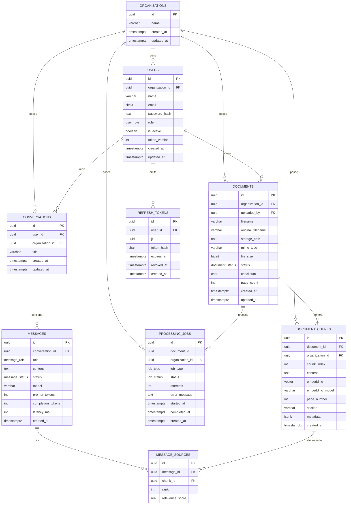
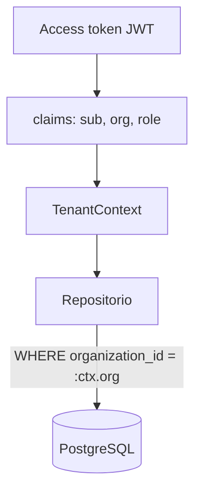

# Base de datos — SmartDocs AI

Modelo de datos, relaciones, índices, aislamiento por organización y estrategia de migraciones.

- **Motor:** PostgreSQL 16.
- **Extensión vectorial:** pgvector.
- **ORM:** SQLAlchemy 2.0 async.
- **Migraciones:** Alembic.
- **IDs:** UUID.
- **Fechas:** `timestamptz` en UTC.

---

## 1. Principios

1. **Toda entidad de negocio pertenece a una organización.** Las tablas multi-tenant incluyen `organization_id`.
2. **El aislamiento se garantiza en la consulta**, no solo en el endpoint.
3. **Integridad referencial explícita** con `ON DELETE` definido por entidad.
4. **Datos derivados se denormalizan solo cuando mejora el filtrado** (por ejemplo, `organization_id` en chunks).
5. **El esquema evoluciona con migraciones versionadas**, nunca con cambios manuales en producción.
6. **La dimensión del vector se fija en la migración.** Cambiar de modelo de embeddings requiere migración y reindexación.

---

## 2. Diagrama entidad-relación



---

## 3. Tipos enumerados

```sql
CREATE TYPE user_role AS ENUM ('ADMIN', 'USER');
CREATE TYPE document_status AS ENUM ('PENDING', 'PROCESSING', 'COMPLETED', 'FAILED');
CREATE TYPE job_status AS ENUM ('PENDING', 'PROCESSING', 'COMPLETED', 'FAILED');
CREATE TYPE job_type AS ENUM ('INGEST', 'REPROCESS');
CREATE TYPE message_role AS ENUM ('USER', 'ASSISTANT');
CREATE TYPE message_status AS ENUM ('ANSWERED', 'NO_INFO', 'ERROR');
```

Reglas:

- Los valores se definen en un único módulo (`app/models/enums.py`) y se reutilizan en schemas.
- Agregar un valor a un enum requiere migración explícita (`ALTER TYPE ... ADD VALUE`).
- En la API se serializan en mayúsculas.

---

## 4. Tablas

### 4.1. `organizations`

Representa a cada empresa cliente.

| Columna | Tipo | Restricciones |
|---|---|---|
| `id` | `uuid` | PK, `gen_random_uuid()` |
| `name` | `varchar(120)` | NOT NULL, UNIQUE |
| `slug` | `varchar(60)` | NOT NULL, UNIQUE |
| `created_at` | `timestamptz` | NOT NULL, default `now()` |
| `updated_at` | `timestamptz` | NOT NULL, default `now()` |

Índices: PK, unique en `name` y unique en `slug`. El `slug` se usa para el login multiempresa.

### 4.2. `users`

| Columna | Tipo | Restricciones |
|---|---|---|
| `id` | `uuid` | PK |
| `organization_id` | `uuid` | NOT NULL, FK → `organizations(id)` `ON DELETE RESTRICT` |
| `name` | `varchar(120)` | NOT NULL |
| `email` | `citext` | NOT NULL |
| `password_hash` | `text` | NOT NULL |
| `role` | `user_role` | NOT NULL, default `'USER'` |
| `is_active` | `boolean` | NOT NULL, default `true` |
| `token_version` | `integer` | NOT NULL, default `0` |
| `created_at` | `timestamptz` | NOT NULL, default `now()` |
| `updated_at` | `timestamptz` | NOT NULL, default `now()` |

Restricciones e índices:

- `UNIQUE (organization_id, id)` — destino de las FK compuestas; impide referencias cruzadas entre organizaciones.
- `UNIQUE (organization_id, email)` — el mismo email puede existir en organizaciones distintas.
- Índice `(organization_id, role)`.
- `token_version` permite invalidar todos los refresh tokens de un usuario al incrementarlo.

> El login requiere `organization_slug`. Esto permite unicidad por organización sin forzar unicidad global de emails.

> Se requiere la extensión `citext` para emails case-insensitive. Alternativa: `varchar` + índice único funcional sobre `lower(email)`.

### 4.3. `refresh_tokens`

Extiende el modelo inicial del documento para cumplir con refresh tokens **revocables**.

| Columna | Tipo | Restricciones |
|---|---|---|
| `id` | `uuid` | PK |
| `user_id` | `uuid` | NOT NULL, FK → `users(id)` `ON DELETE CASCADE` |
| `jti` | `uuid` | NOT NULL, UNIQUE |
| `token_hash` | `char(64)` | NOT NULL (SHA-256 del token) |
| `expires_at` | `timestamptz` | NOT NULL |
| `revoked_at` | `timestamptz` | NULL |
| `created_at` | `timestamptz` | NOT NULL, default `now()` |

Índices:

- `UNIQUE (jti)`.
- `(user_id, expires_at)`.
- `(expires_at)` para limpieza de tokens vencidos.

Reglas:

- El token en claro nunca se almacena.
- En cada refresh se rota: se revoca el actual y se emite uno nuevo.
- Un token revocado o vencido no puede reutilizarse.
- El logout revoca el token presentado.
- Incrementar `users.token_version` invalida todos los tokens del usuario.

### 4.4. `documents`

| Columna | Tipo | Restricciones |
|---|---|---|
| `id` | `uuid` | PK |
| `organization_id` | `uuid` | NOT NULL, FK → `organizations(id)` `ON DELETE CASCADE` |
| `uploaded_by` | `uuid` | NOT NULL, FK compuesta → `users(organization_id, id)` `ON DELETE RESTRICT` |
| `filename` | `varchar(255)` | NOT NULL (nombre saneado) |
| `original_filename` | `varchar(255)` | NOT NULL |
| `storage_path` | `text` | NOT NULL |
| `mime_type` | `varchar(100)` | NOT NULL |
| `file_size` | `bigint` | NOT NULL, `CHECK (file_size > 0)` |
| `status` | `document_status` | NOT NULL, default `'PENDING'` |
| `checksum` | `char(64)` | NOT NULL (SHA-256) |
| `page_count` | `integer` | NULL |
| `created_at` | `timestamptz` | NOT NULL, default `now()` |
| `updated_at` | `timestamptz` | NOT NULL, default `now()` |

Restricciones e índices:

- `UNIQUE (organization_id, id)` — destino de las FK compuestas de chunks y jobs.
- `FOREIGN KEY (organization_id, uploaded_by) REFERENCES users (organization_id, id) ON DELETE RESTRICT`.
- `UNIQUE (organization_id, checksum)` para impedir duplicados exactos dentro de la organización.
- Índice `(organization_id, status)`.
- Índice `(organization_id, created_at DESC)`.
- Índice `(uploaded_by)`.

Reglas:

- El límite de tamaño se valida en la aplicación para poder cambiarlo por configuración.
- Un duplicado devuelve `409 Conflict` con el `id` del documento existente.
- Si en el futuro se requiere versionado, se incorporará una entidad `document_versions` y se quitará la restricción unique.
- Al eliminar un documento se eliminan sus chunks y jobs (`CASCADE`).

### 4.5. `document_chunks`

| Columna | Tipo | Restricciones |
|---|---|---|
| `id` | `uuid` | PK |
| `document_id` | `uuid` | NOT NULL, FK compuesta → `documents(organization_id, id)` `ON DELETE CASCADE` |
| `organization_id` | `uuid` | NOT NULL, FK → `organizations(id)` `ON DELETE CASCADE` |
| `chunk_index` | `integer` | NOT NULL, `CHECK (chunk_index >= 0)` |
| `content` | `text` | NOT NULL, `CHECK (length(content) > 0)` |
| `embedding` | `vector(N)` | NOT NULL |
| `embedding_model` | `varchar(100)` | NOT NULL |
| `page_number` | `integer` | NULL, `CHECK (page_number IS NULL OR page_number > 0)` |
| `section` | `varchar(255)` | NULL |
| `metadata` | `jsonb` | NOT NULL, default `'{}'` |
| `created_at` | `timestamptz` | NOT NULL, default `now()` |

> `N` es `EMBEDDING_DIMENSION`, definido en configuración y fijado en la migración.

Restricciones e índices:

- `UNIQUE (organization_id, id)` — permite ser referenciado con integridad multi-tenant.
- `FOREIGN KEY (organization_id, document_id) REFERENCES documents (organization_id, id) ON DELETE CASCADE`.
- `UNIQUE (document_id, chunk_index)`.
- Índice `(document_id)`.
- Índice `(organization_id)`.
- Índice `(organization_id, document_id)`.
- Índice ANN sobre `embedding` con `vector_cosine_ops`:
  - HNSW (recomendado): `CREATE INDEX ... USING hnsw (embedding vector_cosine_ops);`
  - Alternativa IVFFlat si el volumen es grande y se prefiere menor costo de construcción.
- `metadata` puede incluir: sección, encabezados, offsets, idioma detectado, hash del chunk.

Reglas:

- `organization_id` se copia del documento para permitir filtrado directo sin join.
- La igualdad `document_chunks.organization_id = documents.organization_id` se garantiza con FK compuesta obligatoria y se refuerza en la aplicación.
- Al cambiar `EMBEDDING_MODEL` o `EMBEDDING_DIMENSION`, los vectores existentes quedan incompatibles: se requiere migración, nueva columna/tabla e índice, y reindexación completa.
- El contenido del chunk es dato no confiable; nunca se interpreta como instrucción.

### 4.6. `conversations`

| Columna | Tipo | Restricciones |
|---|---|---|
| `id` | `uuid` | PK |
| `user_id` | `uuid` | NOT NULL, FK compuesta → `users(organization_id, id)` `ON DELETE CASCADE` |
| `organization_id` | `uuid` | NOT NULL, FK → `organizations(id)` `ON DELETE CASCADE` |
| `title` | `varchar(200)` | NOT NULL, default `'Nueva conversación'` |
| `created_at` | `timestamptz` | NOT NULL, default `now()` |
| `updated_at` | `timestamptz` | NOT NULL, default `now()` |

Índices:

- `UNIQUE (organization_id, id)` — destino de referencias multi-tenant.
- `FOREIGN KEY (organization_id, user_id) REFERENCES users (organization_id, id) ON DELETE CASCADE`.
- `(organization_id, user_id, created_at DESC)`.
- `(user_id)`.

Reglas:

- Un usuario solo accede a sus propias conversaciones.
- Un administrador puede consultar conversaciones de su organización solo para fines de auditoría (solo lectura). Esta funcionalidad está definida en la Etapa 8.
- El título puede generarse a partir de la primera pregunta o editarse.

### 4.7. `messages`

| Columna | Tipo | Restricciones |
|---|---|---|
| `id` | `uuid` | PK |
| `conversation_id` | `uuid` | NOT NULL, FK → `conversations(id)` `ON DELETE CASCADE` |
| `role` | `message_role` | NOT NULL |
| `content` | `text` | NOT NULL |
| `status` | `message_status` | NULL (solo assistant) |
| `model` | `varchar(100)` | NULL |
| `prompt_tokens` | `integer` | NULL, `CHECK >= 0` |
| `completion_tokens` | `integer` | NULL, `CHECK >= 0` |
| `latency_ms` | `integer` | NULL, `CHECK >= 0` |
| `created_at` | `timestamptz` | NOT NULL, default `now()` |

Índices:

- `(conversation_id, created_at)`.

Reglas:

- Los mensajes de usuario tienen `role = 'USER'`, `status = NULL`.
- Los mensajes del asistente tienen `role = 'ASSISTANT'` y `status` en `ANSWERED`, `NO_INFO` o `ERROR`.
- No se persiste el prompt completo del sistema por defecto; si se requiere auditoría, se almacena una versión y un hash del prompt.

### 4.8. `message_sources`

| Columna | Tipo | Restricciones |
|---|---|---|
| `id` | `uuid` | PK |
| `message_id` | `uuid` | NOT NULL, FK → `messages(id)` `ON DELETE CASCADE` |
| `chunk_id` | `uuid` | NOT NULL, FK → `document_chunks(id)` `ON DELETE CASCADE` |
| `rank` | `integer` | NOT NULL, `CHECK (rank > 0)` |
| `relevance_score` | `real` | NOT NULL |

Restricciones e índices:

- `UNIQUE (message_id, chunk_id)`.
- Índice `(message_id)`.
- Índice `(chunk_id)`.

Reglas:

- Solo se registran fuentes para respuestas `ANSWERED`.
- `rank` refleja el orden de presentación.
- **Trade-off:** al eliminar o reprocesar un documento se pierden las referencias históricas. Si se requiere auditoría a largo plazo, se agregarán columnas de snapshot (`filename_snapshot`, `page_snapshot`, `content_hash`). Queda como mejora futura.

### 4.9. `processing_jobs`

| Columna | Tipo | Restricciones |
|---|---|---|
| `id` | `uuid` | PK |
| `document_id` | `uuid` | NOT NULL, FK compuesta → `documents(organization_id, id)` `ON DELETE CASCADE` |
| `organization_id` | `uuid` | NOT NULL, FK → `organizations(id)` `ON DELETE CASCADE` |
| `job_type` | `job_type` | NOT NULL, default `'INGEST'` |
| `status` | `job_status` | NOT NULL, default `'PENDING'` |
| `attempts` | `integer` | NOT NULL, default `0` |
| `error_message` | `text` | NULL |
| `started_at` | `timestamptz` | NULL |
| `completed_at` | `timestamptz` | NULL |
| `created_at` | `timestamptz` | NOT NULL, default `now()` |

Índices:

- `UNIQUE (organization_id, id)` — destino de referencias multi-tenant.
- `FOREIGN KEY (organization_id, document_id) REFERENCES documents (organization_id, id) ON DELETE CASCADE`.
- `(document_id, created_at DESC)`.
- `(status)`.
- `(organization_id, created_at DESC)`.

Reglas:

- Un documento puede tener múltiples jobs a lo largo del tiempo.
- Como máximo debe existir un job activo (`PENDING` o `PROCESSING`) por documento. El índice único parcial es obligatorio:

```sql
CREATE UNIQUE INDEX uq_processing_jobs_active
ON processing_jobs (document_id)
WHERE status IN ('PENDING', 'PROCESSING');
```

- `error_message` debe ser accionable y no contener secretos.
- Al arrancar se revisan los jobs en `PENDING` y `PROCESSING`. Los jobs huérfanos y sus documentos se marcan `FAILED` con `error_message = 'Interrumpido por reinicio del proceso'` y `completed_at = now()`, salvo que el documento ya esté `COMPLETED`. Quedan disponibles para reproceso manual.

---

## 5. Multi-tenancy

### 5.1. Estrategia

Esquema compartido con columna `organization_id` en todas las tablas de negocio.



### 5.2. Reglas obligatorias

1. `organization_id` se obtiene **solo** del token autenticado.
2. Se rechaza o ignora cualquier `organization_id` enviado en body, query o headers.
3. Todos los métodos de repositorio reciben el contexto de tenant de forma explícita.
4. La búsqueda vectorial incluye `organization_id = :ctx.org` en el `WHERE`.
5. Los recursos de otra organización responden `404`.
6. Las pruebas de aislamiento cruzado son obligatorias (ver [`testing.md`](testing.md)).
7. Los datos se pueden filtrar por organización aunque la entidad no tenga `organization_id` directo, siempre que exista una relación válida que lo permita (por ejemplo, `messages` vía `conversations`). El scoping sigue siendo obligatorio.

### 5.3. Integridad multi-tenant en base de datos (desde Etapa 3)

Las FK compuestas son obligatorias en el MVP:

- `UNIQUE (organization_id, id)` en `users`, `documents`, `document_chunks`, `conversations` y `processing_jobs`.
- FK compuestas en `documents` (`uploaded_by`), `document_chunks` (`document_id`), `conversations` (`user_id`) y `processing_jobs` (`document_id`).
- Esto impide referencias cruzadas entre organizaciones a nivel de base de datos.

```sql
-- users
UNIQUE (organization_id, id)

-- documents
FOREIGN KEY (organization_id, uploaded_by)
REFERENCES users (organization_id, id)

-- document_chunks
FOREIGN KEY (organization_id, document_id)
REFERENCES documents (organization_id, id)
ON DELETE CASCADE

-- conversations
FOREIGN KEY (organization_id, user_id)
REFERENCES users (organization_id, id)
ON DELETE CASCADE

-- processing_jobs
FOREIGN KEY (organization_id, document_id)
REFERENCES documents (organization_id, id)
ON DELETE CASCADE
```

- **RLS (futuro):** Row Level Security en PostgreSQL como capa adicional. No reemplaza el scoping de la aplicación en el MVP.
- **Auditoría:** registrar intentos de acceso denegados.
- **`message_sources`:** no tiene `organization_id`; su aislamiento se mantiene en aplicación a través de `messages` y `document_chunks`.

---

## 6. Índices y rendimiento

| Tabla | Índice | Motivo |
|---|---|---|
| `users` | `(organization_id, email)` unique | Login y unicidad por organización |
| `users` | `(organization_id, id)` unique | Destino de FK compuestas |
| `refresh_tokens` | `(user_id, expires_at)` | Validación y limpieza |
| `documents` | `(organization_id, id)` unique | Destino de FK compuestas de chunks y jobs |
| `documents` | `(organization_id, status)` | Listado y métricas |
| `documents` | `(organization_id, created_at DESC)` | Listado reciente |
| `document_chunks` | `(organization_id, id)` unique | Destino de referencias multi-tenant |
| `document_chunks` | `(document_id, chunk_index)` unique | Idempotencia del reproceso |
| `document_chunks` | `(organization_id)` | Filtro obligatorio |
| `document_chunks` | `hnsw (embedding vector_cosine_ops)` | Búsqueda semántica |
| `conversations` | `(organization_id, id)` unique | Destino de referencias multi-tenant |
| `conversations` | `(organization_id, user_id, created_at DESC)` | Historial |
| `messages` | `(conversation_id, created_at)` | Orden de mensajes |
| `message_sources` | `(message_id)` | Carga de fuentes |
| `processing_jobs` | `(organization_id, id)` unique | Destino de referencias multi-tenant |
| `processing_jobs` | `(document_id)` unique parcial WHERE `status IN ('PENDING', 'PROCESSING')` | Garantiza un solo job activo |
| `processing_jobs` | `(status)` | Reconciliación y monitoreo |

Notas:

- HNSW mejora latencia de búsqueda a costa de memoria y tiempo de construcción.
- Si se usa IVFFlat, ajustar `lists` según volumen y ejecutar `ANALYZE`.
- Crear el índice ANN después de la carga inicial cuando el volumen sea alto.
- La métrica de distancia debe coincidir entre índice y consulta: coseno (`<=>`).

---

## 7. Migraciones con Alembic

### Reglas

1. Una migración por cambio lógico.
2. Revisar siempre el autogenerate; no confiar ciegamente en él.
3. Nombrar con prefijo temporal y descripción: `0003_create_documents.py`.
4. Incluir `upgrade` y `downgrade` funcionales.
5. Las migraciones deben ser reproducibles desde cero.
6. No modificar migraciones ya aplicadas en producción; crear una nueva.
7. Los enums se crean y modifican explícitamente.
8. La extensión `vector` se crea en la migración inicial: `CREATE EXTENSION IF NOT EXISTS vector;`.
9. La extensión `citext` se crea si se usa ese tipo.
10. Definir convención de nombres para constraints e índices en `alembic/env.py`.
11. Las migraciones deben crear las FK compuestas, los `UNIQUE (organization_id, id)` y el índice único parcial de jobs activos.

### Orden inicial

```text
0001_extensions_y_organizations
0002_users_y_refresh_tokens
0003_documents_y_processing_jobs
0004_document_chunks_y_pgvector
0005_conversations_messages_message_sources
```

**Estado Etapa 2:** `0001` y `0002` implementadas y verificadas. Las migraciones `0003`–`0005` se crean en Etapas 3–6.

### Cambio de modelo de embeddings

Si cambia `EMBEDDING_MODEL` o `EMBEDDING_DIMENSION`:

1. Crear una nueva columna `embedding_v2 vector(M)` o una tabla nueva.
2. Reindexar todos los documentos con el nuevo modelo.
3. Validar calidad con el dataset dorado.
4. Cambiar la configuración y las consultas.
5. Eliminar la columna anterior en una migración posterior.

No se deben mezclar dimensiones en la misma columna indexada.

---

## 8. Retención y borrado

- Eliminar una organización elimina en cascada usuarios, documentos, chunks, conversaciones y jobs. Operación restringida a tareas administrativas fuera de la API pública.
- Eliminar un documento elimina archivo, chunks, jobs y referencias de fuentes.
- Eliminar una conversación elimina mensajes y fuentes.
- El archivo físico se elimina junto con el registro; si falla el borrado del archivo, se registra para limpieza posterior.

---

## 9. Aprovisionamiento inicial y datos de demostración

### 9.1. Aprovisionamiento inicial

No existe registro público de organizaciones ni auto-registro de usuarios.

El primer administrador se crea con un comando de CLI o un seed controlado, por ejemplo:

```text
python -m app.cli create-organization --name "Acme"
python -m app.cli create-admin --org-id <uuid> --email admin@acme.com --name "Admin"
```

Reglas:

- El comando se ejecuta manualmente en el entorno correspondiente.
- No se expone como endpoint público.
- La contraseña se solicita de forma interactiva o se toma de una variable de entorno; nunca por argumento en texto plano.
- El comando es idempotente o falla de forma explícita si la organización o el email ya existen.
- Los usuarios siguientes se crean desde la API por un administrador.

### 9.2. Datos de demostración

Para la Etapa 10 se preparará un seed con:

- Una organización demo.
- Un usuario administrador y uno estándar.
- Documentos de ejemplo en PDF, DOCX y TXT con información verificable.
- Preguntas de ejemplo y respuestas esperadas.

El seed no debe ejecutarse automáticamente en producción.

### 9.3. Auditoría

- En el MVP, la actividad administrativa se deriva de `documents`, `processing_jobs` y `messages`.
- Los accesos denegados se registran en logs estructurados.
- Una tabla `audit_events` persistente queda como mejora futura para retención y consulta detallada.
