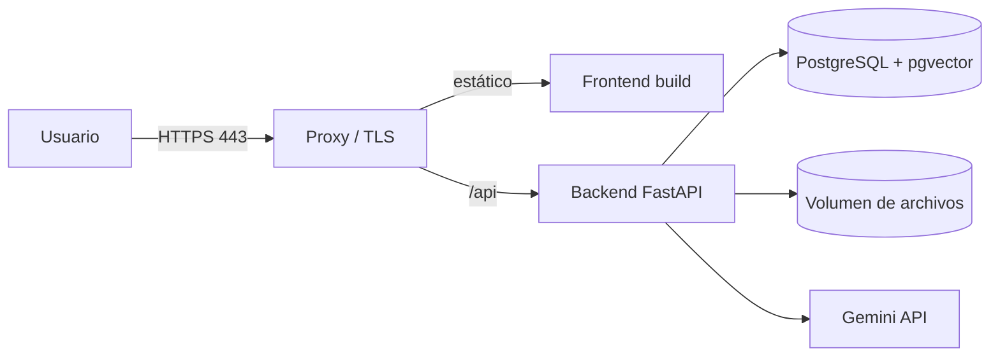

# Despliegue y operación — SmartDocs AI

Preparación del sistema para ejecutarse fuera del entorno local.

- **Contenedores:** Docker + Docker Compose.
- **Base de datos:** PostgreSQL 16 + pgvector.
- **Proxy:** Caddy o Nginx con TLS.
- **Decisión de hosting:** diferida a la Etapa 10 (comparativa al final).
- **Principio:** no asumir que un servicio gratuito permite Docker o pgvector persistente.

> **Estado Etapa 2:** Dockerfile y Docker Compose ya existen y están verificados en local. La API y PostgreSQL funcionan; el proxy TLS, el frontend y la cola durable quedan para etapas posteriores. La topología de esta sección es el objetivo de producción, no la composición actual.

---

## 1. Topología objetivo



Servicios mínimos:

| Servicio | Imagen / artefacto | Persistencia |
|---|---|---|
| `proxy` | Caddy o Nginx | Certificados |
| `frontend` | Build estático servido por el proxy | — |
| `api` | Imagen propia del backend | Volumen de archivos |
| `db` | `pgvector/pgvector:pg16` o PostgreSQL gestionado | Volumen de datos |

---

## 2. Docker

### 2.1. Backend

El `backend/Dockerfile` actual implementa:

- Multi-stage: `builder` con `uv` y `runtime` sobre `python:3.12-slim`.
- Usuario no root (`app`) y directorio de trabajo `/app`.
- Sin secretos embebidos; variables de entorno en runtime.
- `HEALTHCHECK` contra `http://127.0.0.1:8000/health`.
- `uv sync --no-dev --no-install-project` para instalar dependencias desde `uv.lock`.
- Copia de `app/`, `migrations/` y `alembic.ini`.
- `CMD ["uvicorn", "app.main:app", "--host", "0.0.0.0", "--port", "8000"]`.

Build local:

```bash
docker compose build api
```

### 2.2. Frontend (Etapa 7)

- Build con Vite (`pnpm build`).
- Servir estáticos con el proxy o un servidor dedicado.
- Variables de entorno del frontend en tiempo de build (`VITE_API_URL`).

### 2.3. Docker Compose

El `docker-compose.yml` actual de la Etapa 2 define:

- `db`: `pgvector/pgvector:pg16`, volumen `postgres_data`, healthcheck con `pg_isready` y script `docker/postgres/init-test-db.sql` que crea `smartdocs_test`.
- `api`: build desde `./backend`, `env_file: .env` opcional, `DATABASE_URL` apuntando al servicio `db`, volumen `./data/uploads:/app/data/uploads` y dependencia de `db` saludable.
- No incluye `proxy` ni `frontend`; se agregan en etapas posteriores.
- PostgreSQL expone `5432` y la API `8000` en local.

Comandos:

```bash
docker compose up -d db
docker compose run --rm api alembic upgrade head
docker compose up -d --build api
curl http://localhost:8000/health
```

> La composición de producción (proxy TLS, frontend, red interna, backups) se define en la Etapa 10.

---

## 3. Variables de entorno

Ver la tabla completa en [`architecture.md`](architecture.md#9-configuración).

Reglas:

- `.env.example` documenta todas las variables sin secretos.
- `.env` no se versiona.
- En producción, los secretos se gestionan con el proveedor o un gestor dedicado.
- La aplicación valida la configuración al arrancar y falla rápido si falta algo obligatorio.
- No se imprimen secretos en logs.

Variables críticas:

```text
APP_ENV=production
DATABASE_URL=postgresql+asyncpg://...
JWT_SECRET=...
GEMINI_API_KEY=...
FILE_STORAGE_ROOT=/data/uploads
CORS_ORIGINS=https://app.example.com
```

---

## 4. Migraciones y arranque

Opciones:

1. **Entrypoint:** aplicar migraciones antes de iniciar Uvicorn. Simple, adecuado para una instancia.
2. **Paso de release:** ejecutar `alembic upgrade head` como comando separado antes de desplegar. Preferible en producción.

En la Etapa 2 se usa la opción 2: las migraciones se ejecutan explícitamente antes de levantar la API (`docker compose run --rm api alembic upgrade head`). El entrypoint automático queda como decisión futura.

Reglas:

- Nunca ejecutar migraciones automáticas desde múltiples réplicas sin coordinación.
- Hacer backup antes de migraciones destructivas.
- Verificar `downgrade` en local.
- La aplicación no debe arrancar si el esquema no está al día en producción (o debe fallar de forma explícita).

---

## 5. Almacenamiento

### 5.1. MVP

- `LocalFileStorage` con raíz en un volumen persistente.
- Ruta organizada: `/{organization_id}/{document_id}/{filename}`.
- Backup del volumen junto con la base de datos.

### 5.2. Evolución

- S3 u object storage compatible.
- URLs prefirmadas para descargas.
- `FileStorage` permite cambiar sin tocar servicios.

---

## 6. HTTPS y proxy

- TLS obligatorio en producción.
- Caddy puede gestionar certificados automáticamente.
- Redirección de HTTP a HTTPS.
- Cabeceras de seguridad:
  - `Strict-Transport-Security`
  - `X-Content-Type-Options: nosniff`
  - `X-Frame-Options: DENY` o CSP `frame-ancestors`
  - `Referrer-Policy`
  - `Content-Security-Policy` adaptada al frontend
- Límite de tamaño de request alineado con el máximo de archivo.
- Timeouts de proxy mayores que el timeout del LLM.

---

## 7. Base de datos

- PostgreSQL 16 con pgvector.
- Sin exposición pública del puerto.
- Usuario de aplicación con permisos mínimos.
- Conexiones con TLS si el proveedor lo permite.
- Backups automáticos y prueba de restauración.
- Parámetros de conexión y pool dimensionados para una instancia.
- Índice HNSW construido después de la carga inicial si el volumen es alto.

---

## 8. Logging y monitoreo

- Logs estructurados a stdout (capturados por el proveedor).
- Nivel `INFO` en producción; `DEBUG` solo temporal.
- `request_id` en cada request y respuesta.
- Health check para el orquestador.
- Métricas mínimas:
  - Requests por endpoint y estado.
  - Latencia p50/p95.
  - Errores 5xx.
  - Documentos por estado.
  - Jobs fallidos.
  - Consultas `NO_INFO`.
  - Tokens y costo estimado.
- Alertas básicas (futuro): errores 5xx, base caída, jobs fallidos repetidos.

---

## 9. Backups y recuperación

- Backup diario de la base de datos.
- Backup del volumen de archivos.
- Retención definida (por ejemplo, 7 diarios + 4 semanales).
- Prueba de restauración documentada.
- Los backups deben estar cifrados.
- Un backup sin restauración probada no cuenta como backup.

---

## 10. Comparativa de hosting

La decisión se toma en la **Etapa 10**. Criterios:

1. Soporte de Docker o buildpack con Python.
2. PostgreSQL con extensión **pgvector**.
3. Almacenamiento persistente para archivos.
4. HTTPS incluido.
5. Variables de entorno y secretos.
6. Costo predecible.
7. Facilidad de despliegue y logs.
8. Posibilidad de ejecutar migraciones.
9. Región y latencia.
10. Límites de recursos (memoria para HNSW, disco).

| Opción | Ventajas | Riesgos / límites | Ajuste preliminar |
|---|---|---|---|
| **VPS + Docker Compose** | Control total, pgvector, volúmenes, costo predecible | Requiere administrar SO, TLS, backups y seguridad | Alta |
| **Render** | Buen DX, servicios gestionados, deploy simple | Verificar pgvector y persistencia en el plan elegido; costos | Media |
| **Railway** | DX simple, Postgres gestionado | Verificar extensión pgvector, límites y costos | Media |
| **Fly.io** | Contenedores, regiones, volúmenes | Más configuración, Postgres gestionado aparte | Media |
| **Servicios solo gratuitos** | Costo cero | Sin garantías de Docker, pgvector persistente o suspensión por inactividad | Baja |

### Recomendación preliminar

Para un proyecto de portafolio con PostgreSQL + pgvector y control de costos, **VPS con Docker Compose** es la opción más predecible. Si se prioriza simplicidad operativa y el proveedor soporta pgvector, Railway o Render pueden ser suficientes.

La decisión final se registrará como ADR en `decisions.md`.

### Verificaciones obligatorias antes de elegir

- [ ] El plan permite la extensión `vector`.
- [ ] El disco de archivos persiste entre despliegues.
- [ ] Se pueden ejecutar migraciones.
- [ ] El plan permite el tamaño de memoria necesario para el índice.
- [ ] HTTPS y dominio propio están disponibles.
- [ ] Los logs son accesibles.
- [ ] El costo mensual está claro.

---

## 11. Checklist de despliegue

### Antes del despliegue

- [ ] Tests backend y frontend en verde.
- [ ] Ruff y tipos sin errores.
- [ ] Migraciones probadas desde cero.
- [ ] Tests de aislamiento entre organizaciones pasando.
- [ ] Tests de prompt injection pasando.
- [ ] `JWT_SECRET` y `GEMINI_API_KEY` configurados como secretos.
- [ ] `CORS_ORIGINS` restringido al dominio real.
- [ ] `APP_ENV=production`.
- [ ] Documentación de variables actualizada.

### Durante el despliegue

- [ ] Backup previo si hay migraciones.
- [ ] Aplicar migraciones.
- [ ] Crear la organización y el administrador inicial con el comando de CLI.
- [ ] Desplegar API y frontend.
- [ ] Verificar `/health`.
- [ ] Verificar login con el administrador inicial.
- [ ] Verificar carga y procesamiento de un documento.
- [ ] Verificar una consulta con fuentes.
- [ ] Verificar una consulta `NO_INFO`.
- [ ] Verificar que un usuario de otra organización no accede.
- [ ] Verificar HTTPS y cabeceras.

### Después del despliegue

- [ ] Revisar logs de errores.
- [ ] Confirmar backups.
- [ ] Documentar URL, versión y fecha.
- [ ] Registrar la decisión de hosting en `decisions.md`.
- [ ] Preparar datos de demostración.

---

## 12. Operación mínima

- **Alta de organización:** ejecutar el comando de CLI de aprovisionamiento y crear el administrador inicial.
- **Reinicio de API:** verificar reconciliación de jobs y documentos en `PENDING` o `PROCESSING`.
- **Job fallido:** consultar `error_message`, corregir y reprocesar.
- **Base caída:** el health check falla; el orquestador reinicia.
- **Proveedor de IA caído:** las consultas devuelven `502`/`504`; no se pierden datos.
- **Cambio de modelo de embeddings:** requiere reindexación planificada.
- **Rotación de secretos:** actualizar variables y reiniciar.
- **Limpieza:** tokens vencidos, jobs antiguos y archivos huérfanos.

---

## 13. Costos

- El mayor costo variable es el uso de LLM y embeddings.
- Medir tokens por consulta y por organización.
- Evitar llamadas al LLM cuando no hay contexto válido.
- Considerar caché de respuestas para preguntas frecuentes (futuro).
- Documentar precios y supuestos en el informe de la Etapa 9.
